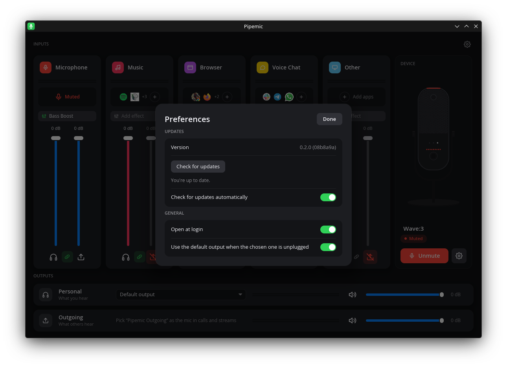

<p align="center"></p>

<h1 align="center">Pipemic</h1>
<p align="center"><b>Audio mixer and mic control for the Elgato Wave:3 on Linux</b><br>
An open-source alternative to Elgato Wave Link, built on PipeWire.</p>

<p align="center">
  <a href="https://github.com/davidboulay/pipemic/releases"></a>
  <a href="LICENSE"></a>
  
  
</p>

<p align="center">
  <a href="#install">Install</a> ·
  <a href="#usage">Usage</a> ·
  <a href="#screenshots">Screenshots</a> ·
  <a href="#troubleshooting">Troubleshooting</a> ·
  <a href="#how-it-works">How it works</a> ·
  <a href="#contributing">Contributing</a>
</p>

---

<p align="center"></p>

Elgato's Wave Link app runs on Windows and macOS only. Pipemic brings the same
workflow to Linux:

- **Control the Wave:3 itself:** mic gain, mute, low cut, Clipguard, headphone
  volume, the monitor mix, and what the front knob controls. A pad tap or a
  knob-mode change on the mic shows up live.
- **Mix your apps into two mixes:** **Personal** (what you hear) and
  **Outgoing** (what others hear). Select *Pipemic Outgoing* as the
  microphone in OBS, Discord, Zoom or Meet.
- **Channels by type:** Microphone, Music, Browser, Voice Chat and Other.
  Apps land in the right channel by their desktop category (Spotify goes to
  Music, Chrome to Browser, Slack to Voice Chat). You can move any app by
  hand, and Other holds the apps you add yourself.
- **Safe by default:** only your mic goes out until you send a channel
  out yourself. That way nothing leaks into a call or stream by surprise.
- **Firmware update check:** Device info compares the mic's firmware with
  Elgato's catalog. Installing an update still needs Wave Link on Mac or Windows.
- **Live meters** for every channel and both mixes, a per-channel fader link,
  and an output picker for your headphones or speakers.
- **Effects per channel:** Elgato's EQ presets from the marketplace. Sign in
  with your Elgato account and free presets install in one click; presets you
  download yourself are picked up from your Downloads folder.
- **Updates and tray:** Pipemic checks for new versions and updates itself.
  Closing the window keeps it mixing in the tray; *Quit* stops it and your
  apps go back to the default speakers and mic.

## Screenshots

| | |
|---|---|
|  |  |
| Gain, low cut, Clipguard, headphone volume, monitor mix and the knob mode. Muted, the channel, the mic art and the button all turn red. | Device info: firmware (checked against Elgato's catalog), hardware and bootloader versions. |
|  |  |
| Effects: the channel's EQ, your presets, and Elgato's marketplace presets. | Apps in a channel: automatic ones can be switched off, any app can be moved in. |
|  |  |
| Marketplace: signed in, free presets install and apply in one click. | Preferences: updates, open at login, output fallback. |
|  | |
| When an update is available, one click installs it. | |

## Supported hardware

| Device | Mixer | Mic control |
|---|---|---|
| Elgato Wave:3 (`0fd9:0070`) | ✅ | ✅ |
| Other Elgato Wave mics (Wave:1, Neo, XLR, Wave:3 MK.2) | ✅ as a plain audio device | ❌ not yet (USB protocol not captured) |

Tested on Arch/CachyOS with PipeWire 1.6 and WirePlumber, on KDE Plasma (Wayland).

## Install

From source (no packages yet).


Requirements: Rust (stable), PipeWire with its development headers, libusb,
clang. `rsvg-convert` is optional and renders the icon sizes.

```sh
# Arch / CachyOS
sudo pacman -S --needed rust clang libpipewire libusb librsvg

git clone https://github.com/davidboulay/pipemic
cd pipemic

# Let your user talk to the mic without root, then replug it
sudo install -m644 udev/70-elgato-wave.rules /etc/udev/rules.d/
sudo udevadm control --reload && sudo udevadm trigger -s usb

# Build and install for your user (~/.local)
./packaging/install-user.sh
```

Then open **Pipemic** from your app menu. The mixer runs while Pipemic does:
closing the window keeps it in the tray, and *Quit* in the tray menu stops it and
puts your apps back on the default speakers and mic. To update, use *Preferences → Check
for updates*, or `git pull` and re-run the install script.

## Usage

1. **Pick the mic in your apps.** In Slack, Meet, Zoom, Discord or OBS, choose
   **Pipemic Outgoing** as the microphone. Keep your speakers or headphones as
   the output: the Personal mix plays there.
2. **Let apps sort themselves.** Music players land in Music, browsers in
   Browser, chat apps in Voice Chat. Click a channel's app icons to switch an
   automatic app off or move any app in by hand.
3. **Set two levels per channel.** The left fader is what you hear (Personal),
   the right one what others hear (Outgoing). The link button moves both together.
4. **Send a channel out on purpose.** Only the mic goes to Outgoing at first.
   The send button under a channel turns it on; red means it stays private.
5. **Add effects.** A channel's effects chip opens its EQ, your presets and
   Elgato's marketplace. Sign in to Elgato once to install free presets in one click.
6. **Control the mic.** The Wave:3 panel has mute and the gear for gain, low
   cut, Clipguard, headphone volume, monitor mix and the knob mode.

Everything is scriptable from a terminal too:

```sh
pipemicctl get                      # mic info, config and status
pipemicctl mix                      # the channel × mix matrix
pipemicctl mix channel music -12    # Music 12 dB down in every mix
pipemicctl mix mic gain 30          # Wave:3 gain to 30 dB
pipemicctl mix mic mute             # same as tapping the pad
pipemicctl watch                    # print every change made on the mic itself
```

## Troubleshooting

| Symptom | What to do |
|---|---|
| The mic shows *Live* but nothing is captured | After a replug the Wave:3 can come back on an output-only profile. Pipemic switches it back by itself within a few seconds; if not, pick *Analog Stereo Output + Mono Input* for the Wave:3 in your sound settings. |
| My voice sounds robotic | Update Pipemic: older versions let the Wave:3 run on another device's clock. `pw-top` should list the Wave:3 source as its own driver. |
| The mic is quiet | Raise *Mic gain* in the Wave:3 panel. Apps with automatic gain control (and system volume sliders on the Wave:3 source) move the same hardware gain. |
| Sound stays routed after closing the window | Closing keeps Pipemic in the tray. Use *Quit* in the tray menu to stop mixing. |
| `pipemicctl` says permission denied | Install the udev rule (see Install) and replug the mic. |

Logs: `journalctl --user -u pipemicd`.

## How it works

| Part | What it does |
|---|---|
| `pipemicd` | User daemon (systemd user unit, started and stopped by the app). Creates one virtual sink per channel and one in-process filter-chain per mix, wires them, routes apps, meters levels and talks to the mic over USB. |
| `pipemic` | The mixer window (Rust, [iced](https://iced.rs)). Talks to the daemon over `$XDG_RUNTIME_DIR/pipemicd.sock`. |
| `pipemicctl` | Command-line control: `pipemicctl get`, `pipemicctl watch`, `pipemicctl mix channel music -6`, … |
| `wave-proto` | The Wave:3 USB control protocol (vendor interface 3), documented in [`docs/wave3-protocol.md`](docs/wave3-protocol.md). |

```
 apps ──► channel sinks ──► channel effects ──┬──► Personal mix ──► your speakers / headphones
 Wave:3 ──► clock bridge ──► mic effects ─────┴──► Outgoing mix ──► "Pipemic Outgoing" (the mic apps pick)
```

Mixer settings live in `~/.config/pipemic/mixer.toml`. All PipeWire objects
belong to the daemon and disappear when it stops; apps it moved go back to
your default output.

## Status

Pipemic is young and works day to day on the author's machine. These aren't
built yet: noise suppression, installing firmware updates (checking works), upside-down mode, and Stream
Deck integration.

## Contributing

Issues and pull requests are welcome.

```sh
cargo build                 # all crates
cargo test                  # unit tests (protocol, mixer model, catalog, app categories)
cargo clippy --workspace    # lints
./packaging/install-user.sh # install your build and restart it
```

- Protocol notes: [`docs/wave3-protocol.md`](docs/wave3-protocol.md), firmware update research in [`docs/wave3-dfu.md`](docs/wave3-dfu.md).
- Other Elgato mics need their USB control messages captured. If you own one, open an issue.
- Tests never use a real serial number (`SERIAL000001`).

## License

MIT. See [LICENSE](LICENSE).

---

<sub>Pipemic is an independent project. It is not affiliated with, endorsed by,
or sponsored by Elgato or Corsair. Elgato, Wave, Wave:3 and Wave Link are
trademarks of Corsair Memory, Inc., used here only to describe compatibility.</sub>
