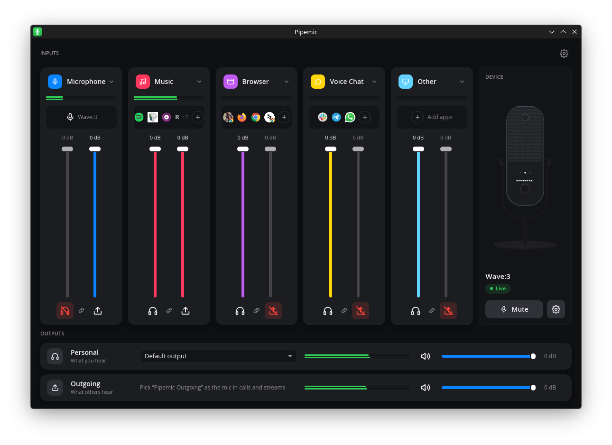
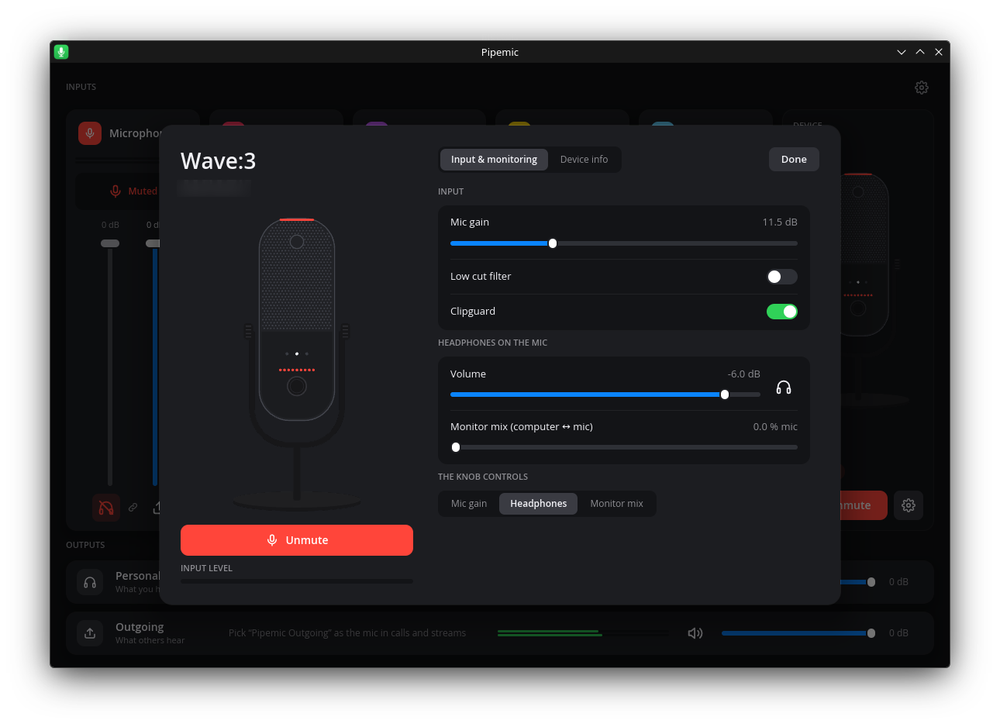
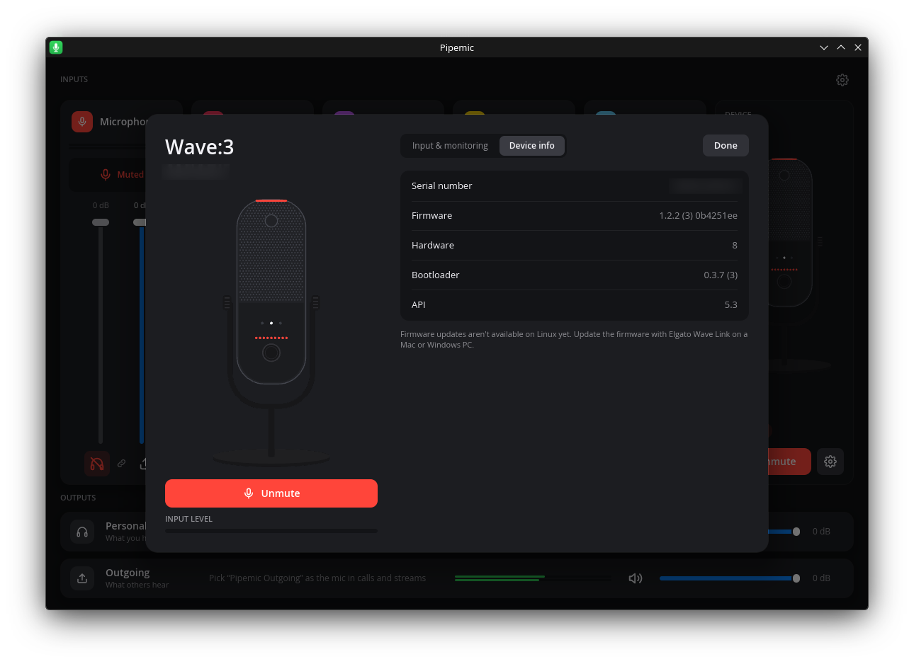
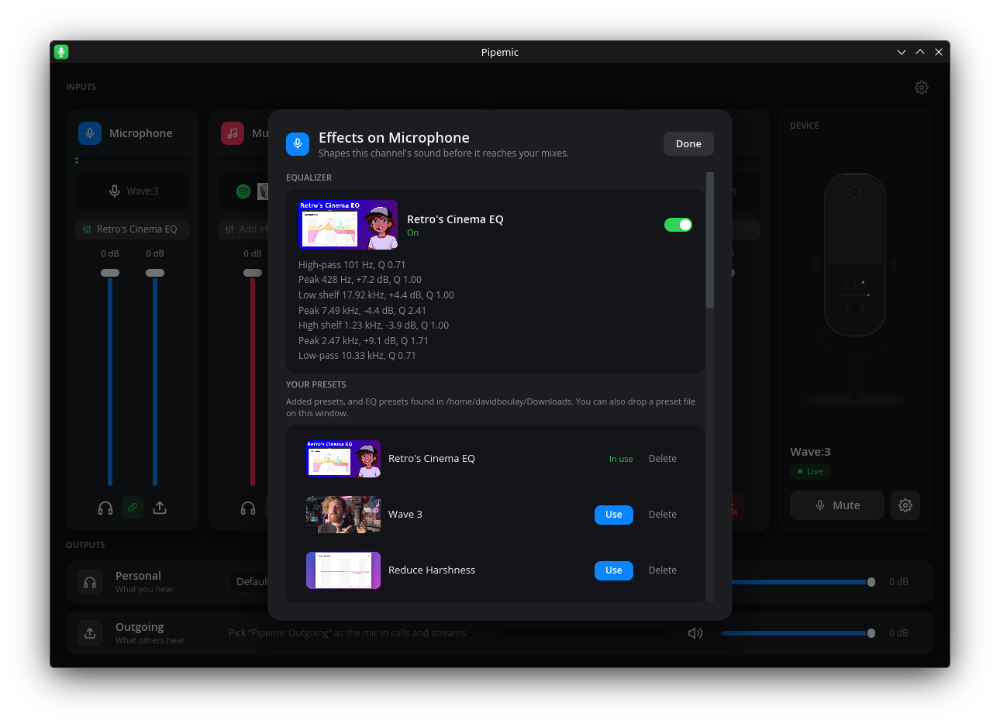
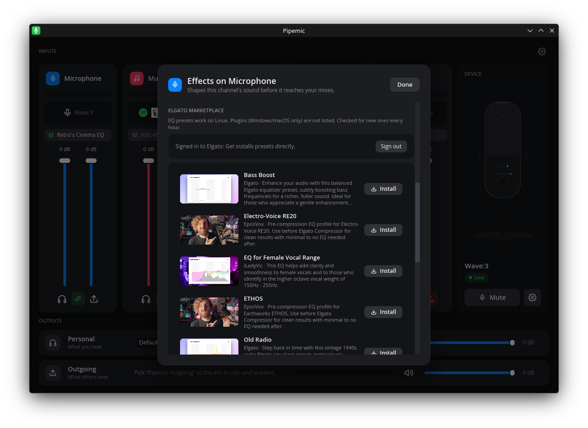
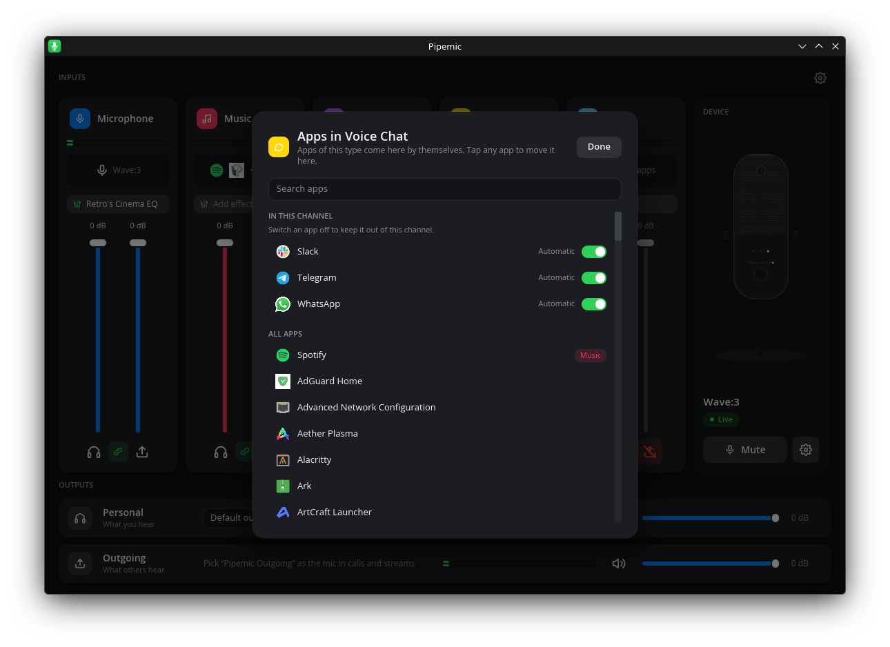
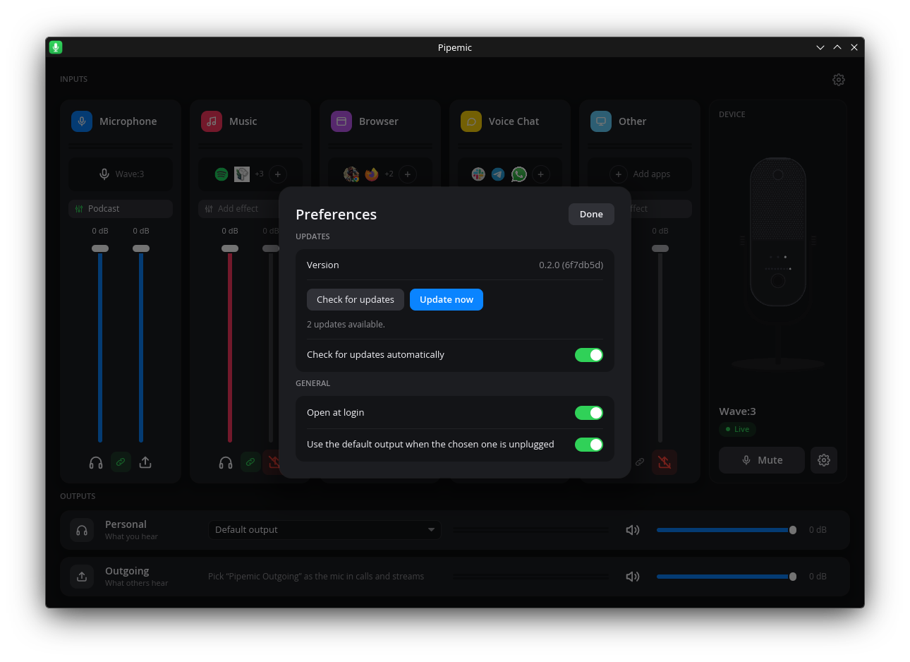

<div align="center">


<h1>Pipemic</h1>

**Audio mixer and mic control for the Elgato Wave:3 on Linux**: Wave Link's
two-mix workflow,<br>built on PipeWire.

[](https://github.com/davidboulay/pipemic/releases/latest)
[](https://github.com/davidboulay/pipemic/actions/workflows/ci.yml)
[](#install)
[](#supported-hardware)
[](LICENSE)

[**Install**](#install) · [Features](#features) · [Using it](#using-pipemic) · [Troubleshooting](#when-the-mic-misbehaves) · [How it's built](#how-its-built) · [Project page](https://davidboulay.com/apps/pipemic/)

</div>

<br>

Elgato's Wave Link only runs on Windows and macOS. On Linux the Wave:3 works as
a plain USB mic, and everything that makes it more than that is out of reach.
Pipemic brings it back: **control the mic itself** (gain, mute, low cut,
Clipguard, headphones, the monitor mix, the knob), and **mix your apps into two
mixes**: what you hear, and what your call or stream hears.

It's **safe by default**: only your mic goes out until you send a channel out
yourself, so Spotify never ends up in a meeting by surprise.



<sub>**The mixer.** Five channels, each with a fader for what you hear and one for what others hear. The Wave:3 panel follows the real mic: tap its pad and the UI mutes.</sub>

## Features

- **Wave:3 control over USB:** mic gain, mute, low cut, Clipguard, headphone
  volume, the computer ↔ mic monitor mix, and what the front knob controls. Turn
  the knob or tap the pad on the mic and the change shows live. Red LED on the
  mic means muted in PipeWire, always.
- **Two mixes:** **Personal** plays on your speakers or headphones; **Outgoing**
  is a virtual mic called *Pipemic Outgoing* that you pick in Slack, Meet,
  Zoom, Discord or OBS.
- **Channels by type:** Microphone, Music, Browser, Voice Chat and Other. Apps
  land in the right one by their desktop category (Spotify → Music, Firefox →
  Browser, Slack → Voice Chat). Every automatic app can be switched off, and any
  app can be moved by hand.
- **Safe by default:** only the mic is sent out at first. The send button under
  each channel shows what leaves your computer.
- **Effects per channel:** an EQ on any channel, using Elgato's marketplace EQ
  presets. Sign in to Elgato once and free presets **install and apply in one
  click**; presets you download yourself are picked up from Downloads.
- **Live meters** on every channel and both mixes, a per-channel fader link, and
  an output picker that falls back to the default output when a device is unplugged.
- **Stays out of the way:** closing the window keeps mixing from the **tray**
  (with a mute toggle); *Quit* stops everything and your apps go back to the
  default speakers and mic.
- **Updates itself:** *Preferences → Check for updates*, then one click. The
  mic's **firmware** is checked against Elgato's catalog too.
- **Scriptable:** `pipemicctl` does everything from a terminal.
- **Heals the usual Wave:3 quirks:** after a replug the mic can come back
  without its input; Pipemic switches it back. The mic runs on its own clock, so
  no robot voice when it meets a USB dock's audio.

## Screenshots

| | |
|---|---|
|  |  |
| <sub>**Mic settings.** Gain, low cut, Clipguard, headphone volume, monitor mix and the knob mode. Muted, everything turns red.</sub> | <sub>**Device info.** Firmware, hardware and bootloader, with a firmware check against Elgato's catalog.</sub> |
|  |  |
| <sub>**Effects.** The channel's EQ with its bands, and your presets.</sub> | <sub>**Marketplace.** Signed in, free presets install and apply in one click.</sub> |
|  |  |
| <sub>**Apps.** Automatic apps can be switched off; any app can be moved in.</sub> | <sub>**Preferences.** Updates, open at login, output fallback.</sub> |

## Install

Developed on **CachyOS (Arch) with KDE Plasma (Wayland), PipeWire 1.6 and
WirePlumber**. Any distro with PipeWire should work; there are no packages yet,
so build it from the tree.

```bash
# Arch / CachyOS / Manjaro
sudo pacman -S --needed rust clang libpipewire libusb gtk3 webkit2gtk-4.1 librsvg

git clone https://github.com/davidboulay/pipemic && cd pipemic

# Let your user talk to the mic without root, then replug it
sudo install -m644 udev/70-elgato-wave.rules /etc/udev/rules.d/
sudo udevadm control --reload && sudo udevadm trigger -s usb

./packaging/install-user.sh   # release build → ~/.local/bin, app entry, icons, user service
```

Then open **Pipemic** from your app menu. On Debian/Ubuntu the build packages
are `cargo clang pkg-config libpipewire-0.3-dev libusb-1.0-0-dev libgtk-3-dev
libwebkit2gtk-4.1-dev`. `librsvg` is optional (it renders the icon sizes); GTK
and WebKit are only for the Elgato sign-in window.

**Updating:** *Preferences → Check for updates* pulls, rebuilds and restarts
Pipemic. Or `git pull` and run the install script again.

**Uninstalling:** *Quit* from the tray, then remove `~/.local/bin/pipemic*`,
`~/.config/systemd/user/pipemicd.service` and, if you like, `~/.config/pipemic/`.

### Supported hardware

| Device | Mixer | Mic control |
|---|---|---|
| Elgato Wave:3 (`0fd9:0070`) | ✅ | ✅ |
| Other Elgato Wave mics (Wave:1, Neo, XLR, Wave:3 MK.2) | ✅ as a plain audio device | ❌ not yet: their USB protocol hasn't been captured |

## Using Pipemic

1. **Pick the mic in your apps.** Choose **Pipemic Outgoing** as the microphone
   in calls and streams. Keep your normal speakers or headphones as the output.
2. **Let apps sort themselves.** Click a channel's app icons to switch an
   automatic app off, or to move any app in.
3. **Two faders per channel.** Left: what you hear (Personal). Right: what
   others hear (Outgoing). The link button moves both together.
4. **Send a channel out on purpose.** The send button under a channel turns it
   on for Outgoing; red means it stays private.
5. **Add effects.** A channel's effects chip opens its EQ, your presets and the
   marketplace.
6. **Control the mic.** The Wave:3 panel has mute, and the gear opens gain,
   low cut, Clipguard, headphones, monitor mix and the knob mode.

| Where | What it does |
|---|---|
| Close the window | Keeps mixing; the tray icon reopens it |
| Tray → *Mute mic* | Same as tapping the pad on the Wave:3 |
| Tray → *Quit* | Stops mixing; apps go back to the default speakers and mic |
| *Preferences → Open at login* | Starts Pipemic in the tray when you log in |

Everything is scriptable:

```bash
pipemicctl get                          # mic info, settings and status
pipemicctl watch                        # print every change made on the mic itself
pipemicctl mix                          # the channel × mix matrix
pipemicctl mix channel music -12        # Music 12 dB down in every mix
pipemicctl mix mic gain 30              # Wave:3 gain to 30 dB
pipemicctl mix mic mute                 # same as tapping the pad
pipemicctl mix eq mic import preset.xml # an Elgato EQ preset on the mic
pipemicctl fw check                     # is the mic's firmware the latest?
```

## When the mic misbehaves

| Symptom | Why, and what to do |
|---|---|
| The mic shows *Live* but nothing is captured | After a replug the Wave:3 can come back on an output-only profile. Pipemic switches it back within a few seconds; if not, pick *Analog Stereo Output + Mono Input* for it in your sound settings. |
| Robot voice in calls | The mic was following another device's clock (a USB dock, say). Pipemic gives it its own; `pw-top` should list the Wave:3 source as a driver, not under another device. |
| The mic is quiet | Raise *Mic gain*. The Wave:3's PipeWire volume **is** its hardware gain, so an app's automatic gain control or a system volume slider can lower it. |
| Sound still routed after closing | Closing keeps Pipemic in the tray. Use *Quit*. |
| `pipemicctl`: permission denied | Install the udev rule (see [Install](#install)) and replug the mic. |
| Something else | `journalctl --user -u pipemicd` shows what the mixer did, and `pipemicctl watch` what the mic reports. Include a few lines in a bug report. |

## How it's built

Rust, in a few crates. The mixer runs as a user daemon so the audio keeps going
whether the window is open or not; the window, the tray and the CLI are clients.

```
 apps ──► channel sinks ──► channel effects ──┬──► Personal mix ──► your speakers / headphones
 Wave:3 ──► clock bridge ──► mic effects ─────┴──► Outgoing mix ──► "Pipemic Outgoing" (the mic apps pick)
```

| Need | How |
|---|---|
| Channels and mixes | One virtual sink per channel, one in-process `filter-chain` per mix, linked by the daemon |
| App routing | Desktop categories from `.desktop` files; streams moved with PipeWire metadata |
| Effects | Biquad EQ in `filter-chain`, built from Elgato's EQ preset XML |
| Mic clock | `module-loopback` bridge with its two halves on separate drivers |
| Mic control | Wave:3 vendor USB interface 3 via `rusb`, polled every 200 ms |
| Window and tray | [iced](https://iced.rs) 0.14, StatusNotifierItem via `ksni` |
| Elgato sign-in | A small `wry` web view that keeps the marketplace session |

| Crate | Role |
|---|---|
| `pipemicd` | The mixer daemon: sinks, mixes, links, app routing, meters, mic USB thread. Control socket at `$XDG_RUNTIME_DIR/pipemicd.sock` (JSON lines). |
| `pipemic` | The mixer window and tray. Starts the daemon; *Quit* stops it. |
| `pipemicctl` | The command line. |
| `wave-proto` | Wave:3 USB protocol, documented in [`docs/wave3-protocol.md`](docs/wave3-protocol.md). |
| `wave-catalog` | Elgato's firmware catalog and marketplace. |
| `desktop-apps` | Installed apps and their categories. |
| `pipemic-login` | The Elgato sign-in window. |

## Configuration & data

| Path | What |
|---|---|
| `~/.config/pipemic/mixer.toml` | Channels, mixes, levels, routing, effects. Written on every change. |
| `~/.local/share/pipemic/presets/` | Installed EQ presets |
| `~/.local/share/pipemic/elgato-session.json` | Elgato sign-in session; *Sign out* deletes it |
| `~/.cache/pipemic/addons/` | Marketplace thumbnails |

Every PipeWire object belongs to the daemon and disappears when it stops; apps
it moved go back to your default output.

## Limitations

- **Wave:3 only** for mic control. Other Elgato mics work as plain audio devices.
- **Firmware updates** are checked, not installed: install them with Wave Link
  on a Mac or Windows PC for now.
- **EQ presets only** from the marketplace. Plugins there are Windows/macOS builds.
- **Not built yet:** noise suppression, upside-down mode, Stream Deck integration.

## Contributing

Issues and pull requests are welcome. CI builds every PR and runs the tests and
Clippy with warnings as errors; do the same locally:

```bash
cargo build && cargo test
cargo clippy --workspace --all-targets -- -D warnings
./packaging/install-user.sh     # try your build as the real app
```

Own another Elgato mic? Its USB control messages need capturing before Pipemic
can drive it; open an issue. Tests use a fake serial (`SERIAL000001`).

## License

MIT. See [LICENSE](LICENSE).

<sub>Pipemic is an independent project. It is not affiliated with, endorsed by,
or sponsored by Elgato or Corsair. Elgato, Wave, Wave:3 and Wave Link are
trademarks of Corsair Memory, Inc., used here only to describe compatibility.</sub>
